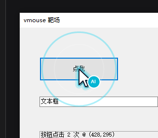
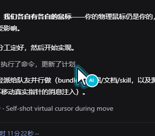

# 虚拟鼠标（dsh-vmouse）

> 给 DSH 里的 agent 单独一只鼠标：屏幕上有它自己的青色光标，点击、拖动、滚动都不移动、不占用你的真实鼠标指针。

这是 DSH（DeepSeek Harness Desktop）的插件（bundle）。装上后 agent 多出 5 个 `mcp__vmouse__*` 工具和 1 个 `virtual-mouse` skill，可以在 Windows 桌面上做 UI 操作和测试——**你随时可以继续用自己的鼠标**。



*（上图：agent 的光标点在靶场按钮上，波纹表示刚点过这里；状态栏显示按钮已被点击 2 次。）*

## 为什么用它

- **不抢你的鼠标**：不移动真实指针、不抢占输入，agent 操作界面时你照常使用电脑。
- **看得见、可核对**：每次操作屏幕上都会出现青色光标，点击还会留下波纹，截图里也能看到，方便确认落点。
- **不打扰**：置顶浮层但鼠标完全穿透、不抢焦点、不进任务栏；约 3.2 秒后自动淡出。
- **干净**：纯本地运行，无第三方 npm 依赖、不联网、无遥测，不需要管理员权限。
- **跨版本稳定**：以 MCP server 形式接入，不依赖 DSH 内部 Host API，升级 DSH 后通常不用改插件。

## 它长什么样

| 元素 | 含义 |
|---|---|
| 青色箭头 + AI 徽标 | agent 自己的虚拟光标，和你的真实鼠标指针相互独立 |
| 点击波纹 | 在这里刚点击/拖动/滚动过，用来核对落点 |
| 置顶浮层 | 始终可见、鼠标穿透、不抢焦点、不进任务栏，约 3.2 秒后淡出 |



*（上图：agent 把虚拟光标移到 DSH 聊天界面上；此时你的真实指针仍停在原处。）*

## 工作原理（3 行）

1. 一个常驻 PowerShell（STA）进程创建置顶**分层窗口**（`WS_EX_LAYERED | WS_EX_TRANSPARENT | WS_EX_NOACTIVATE | WS_EX_TOOLWINDOW`），用 `UpdateLayeredWindow` + `AC_SRC_ALPHA` 逐像素画光标和波纹。
2. 点击、拖动、滚动通过 **PostMessage 投递窗口消息**（`WM_MOUSEMOVE` / `WM_LBUTTONDOWN` / `WM_LBUTTONUP` / `WM_MOUSEWHEEL` 等）注入到目标窗口，先解析目标窗口与客户区坐标。
3. 默认路径**不调用 `SetCursorPos` / `mouse_event` / `SendInput`**，真实指针一动不动；只有显式传 `real: true` 时才短暂借用真实指针完成操作，然后复原。

## 与真实鼠标工具的区别

| 对比项 | 虚拟鼠标 `mcp__vmouse__*` | 真实鼠标 `mcp__desktop__mouse_*` |
|---|---|---|
| 光标 | 浮层里的独立青色箭头 | 系统真实指针 |
| 用户鼠标 | 不移动、不占用，可同时使用 | 被抢占，移动和点击会干扰用户 |
| 注入方式 | 窗口消息（不经过真实输入硬件） | `SendInput` / `mouse_event` 模拟真实输入 |
| 适用面 | 常规 Win32 / 桌面程序、Chromium / Electron | 几乎所有程序，包括游戏、画布、原始输入 |
| 何时选 | 默认首选：桌面点击/拖动/滚动测试、不想打扰用户时 | 虚拟鼠标无效时再用 |

选择原则：**优先虚拟鼠标，失败再回退真实鼠标。**

## 工具

所有坐标都是**物理像素**，与 `mcp__desktop__screen_capture` 截图的像素坐标一致，不需要 DPI 换算。

| 工具 | 参数 | 说明 |
|---|---|---|
| `mcp__vmouse__click` | `{x, y, button?, clicks?, real?, hwnd?, window?}` | 在 (x, y) 点击。`button`：`left`（默认）/`right`/`middle`；`clicks`：连击次数，默认 1（双击传 2，消息注入最多 3）；`real`：默认 `false`，为 `true` 时短暂借用真实指针点击后复原；`hwnd`/`window`：把点击直接投递给指定窗口（句柄或标题包含的文字），可点被遮挡的窗口 |
| `mcp__vmouse__move` | `{x, y}` | 把虚拟光标移到 (x, y) 并短暂显示（带 200ms 滑行），用于悬停、展示位置、确认坐标 |
| `mcp__vmouse__drag` | `{from_x, from_y, to_x, to_y, button?, real?}` | 从起点按住拖到终点再松开；`button` 默认 `left` |
| `mcp__vmouse__scroll` | `{x, y, delta_y, hwnd?, window?}` | 在 (x, y) 滚动：`delta_y` 正数向上、负数向下，一格约 120；可指定目标窗口 |
| `mcp__vmouse__status` | `{}` | 自检：浮层是否可见、虚拟光标坐标、真实指针坐标、最近一次操作（不会让光标出现） |

`click` 的响应会带上**操作前后真实指针坐标**（`realBefore` / `realAfter`），`move` / `scroll` 的响应也会返回真实指针坐标；可以直接核对「真实指针没被动过」。

附带 skill `virtual-mouse`，会教 agent 什么时候用虚拟鼠标、坐标怎么来、失败时的回退顺序。

## 安装

> 系统要求：Windows 10 / 11；安装后不需要单独装 Node.js 或 PowerShell 模块（DSH 自带 Node，系统自带 PowerShell 5.1）。安装后插件在「设置 → 插件」里显示为 **「虚拟鼠标（agent 自己的光标）」**。

### 方式 A【推荐 · 不用装任何东西】把一句话发给你 DSH 里的 agent

复制下面这句话，发给任意 DSH 对话里的 agent：

```text
帮我安装虚拟鼠标插件：用 plugin_manager 的 install_bundle，target 传 https://github.com/<你的GitHub用户名>/dsh-vmouse/archive/refs/tags/v1.0.0.tar.gz
```

agent 会让 pnpm 直接从 GitHub 拉 tarball 安装，**不需要安装 git**。装好后让 agent 调一次 `mcp__vmouse__status` 验证；如果这时还看不到 `mcp__vmouse__*` 工具，重新打开一次 DSH Desktop 即可。

### 方式 B【命令行】完全退出 DSH Desktop 后，在仓库目录运行安装

1. **完全退出 DSH Desktop**（包括托盘图标，确认进程已结束）。
2. 在仓库目录（`D:\配置\dsh-vmouse` 这种解压/克隆后的目录）任选其一：
   - 运行 `install.cmd`（仓库自带的一键脚本；会先检查 DSH 已退出、`dsh` 命令可用，再执行安装，`install.cmd --dry-run` 只预览不安装）；
   - 或手动执行：

     ```bat
     dsh plugin --profile desktop add "link:D:\配置\dsh-vmouse"
     ```

     把 `D:\配置\dsh-vmouse` 换成你的仓库绝对路径。
3. 重新打开 DSH Desktop。

命令行方式采用 `link:` 安装，插件直接引用仓库目录，**改代码后重启 DSH 即生效**，适合开发调试。

### 方式 C【手动/离线】下载仓库 zip 解压后让 agent 安装

1. 下载仓库 zip 并解压到任意目录，例如 `D:\插件\dsh-vmouse`。
2. 让 agent 执行（target 传解压后的**绝对路径**）：

   ```yaml
   action: install_bundle
   target: D:\插件\dsh-vmouse
   ```

### 怎么确认装好了

1. 「设置 → 插件」里出现 **「虚拟鼠标（agent 自己的光标）」**，描述里提到独立的青色光标。
2. 让 agent 调 `mcp__vmouse__status`，能返回浮层状态、虚拟光标与真实指针坐标。
3. 让 agent `mcp__vmouse__move` 到一个坐标，屏幕上能看到青色光标出现并淡出。

更多细节与排障见 [docs/INSTALL.md](docs/INSTALL.md)。

## 自己验证（仓库自带测试）

- `test\testtarget.ps1`：WinForms 靶场。窗口固定在屏幕 (300,180)，大小 460x360，有按钮「点我」、文本框和状态栏；启动后把控件坐标写入 `test\target.json`，把收到的点击写入 `test\clicks.log`。
- `test\rpc.mjs`：MCP stdio 冒烟脚本，走 `initialize → tools/list → status → move → click → status`。

```powershell
# 1) 启动靶场（后台）
Start-Process powershell.exe -ArgumentList '-NoProfile','-STA','-ExecutionPolicy','Bypass','-File','D:\配置\dsh-vmouse\test\testtarget.ps1' -PassThru

# 2) 等 target.json 出现后，读取按钮中心坐标
$t = Get-Content 'D:\配置\dsh-vmouse\test\target.json' -Raw | ConvertFrom-Json

# 3) 跑 MCP 冒烟脚本（显式指定本仓库的 server.mjs）
node 'D:\配置\dsh-vmouse\test\rpc.mjs' --server 'D:\配置\dsh-vmouse\server.mjs' --x $t.button_center.x --y $t.button_center.y

# 4) 查看靶场收到的点击；确认按钮点击次数、真实指针坐标未变
Get-Content 'D:\配置\dsh-vmouse\test\clicks.log'
```

（`test\target.json`、`test\clicks.log`、`test\testtarget.error.log` 是运行时产物，已被 `.gitignore` 忽略。）

> 如果本机没有全局 `node` 命令，把命令里的 `node` 换成 DSH 自带的 `node.exe`（路径与查找顺序见 [docs/INSTALL.md](docs/INSTALL.md) 的「排障」）。

## 实测情况

在 Windows 10/11（1920x1200）上已实测：

- **WinForms 靶场**：左键 / 双击 / 右键、拖动选中文本、点击命中子控件全部生效；每次操作前后真实指针坐标完全一致。
- **Chromium / Electron 窗口**（含 DSH 自身的聊天界面）：点击输入框、点开附件菜单都被接受。
- **浮层**：置顶、鼠标完全穿透、不进任务栏、不抢焦点；操作后出现青色光标与波纹，约 3.2 秒后淡出，截图里也能看到（可用来核对落点）。

## 已知限制

- **游戏 / Raw Input / DirectX·Vulkan 画布**：这类程序通常不处理窗口消息，注入无效。给 `click` / `drag` 传 `real: true`，会短暂移动真实指针完成操作再复原（用户可能看到一次瞬时跳动）。
- **UIPI**：普通权限进程不能操作以管理员身份运行的窗口，除非 DSH 自身也以管理员运行。
- **Windows 10/11 专用**：分层窗口与窗口消息注入由 PowerShell 调 Win32 API 实现。
- **依赖系统 PowerShell 5.1**（Windows PowerShell `powershell.exe`，不是 `pwsh`）与 Node.js（DSH 自带的即可；`launch.ps1` 会自动查找，可用环境变量 `DSH_VMOUSE_NODE` 指定 `node.exe`）。
- **坐标是物理像素**，不是 DPI 缩放后的逻辑像素。
- `real: true` 是强制借用真实指针，**会短暂打断用户**，只作为兜底。

## 安全提示

这个插件能在屏幕上画浮层、向窗口注入点击鼠标消息，能力等同于本机 UI 自动化工具。虽然它不联网、无遥测、只写 `test\` 下的本地验证日志，仍建议在安装前审阅代码：

- `server.mjs`：MCP stdio 服务，声明工具并转发请求。
- `vmouse.ps1`：常驻 PowerShell，画浮层、投递窗口消息。
- `launch.ps1`：找到 Node.js 并启动 `server.mjs`。

全部是明文脚本，无压缩混淆、无第三方依赖，可按需自查。

## 目录结构

```text
dsh-vmouse\
├─ package.json                       # 包信息（dsh.bundle 指向 cordis.patch.yml）
├─ cordis.patch.yml                   # bundle patch：注册 MCP server 与 skill
├─ launch.ps1                         # 启动器：找到 Node.js 并运行 server.mjs
├─ server.mjs                         # MCP stdio server，声明 5 个工具
├─ vmouse.ps1                         # 常驻 PowerShell：分层窗口浮层 + 窗口消息注入
├─ install.cmd                        # 命令行方式的一键安装脚本（link 安装）
├─ uninstall.cmd                      # 命令行方式的一键卸载脚本
├─ icon.svg                           # 插件图标
├─ locale\                            # 界面文案（zh.json / en.json）
│   ├─ zh.json
│   └─ en.json
├─ skills\virtual-mouse\SKILL.md      # agent 使用说明（virtual-mouse skill）
├─ test\
│   ├─ testtarget.ps1                 # WinForms 点击靶场
│   └─ rpc.mjs                        # MCP 冒烟脚本
├─ docs\
│   ├─ INSTALL.md                     # 安装与排障
│   ├─ ARCHITECTURE.md                # 架构与实现细节
│   └─ images\                        # 截图（ripple.png / cursor.png）
├─ scripts\pack.ps1                   # 打包脚本（生成 npm 风格 tgz，输出到 dist\）
├─ .github\workflows\release.yml      # 打 tag 时自动打包并发布 GitHub Release
├─ README.md
├─ CHANGELOG.md
├─ LICENSE
└─ .gitignore
```

（`dist\` 是打包产物、`node_modules\` 与 `test\` 下的日志是运行时产物，均已被 `.gitignore` 忽略。）

## 卸载

任选其一：

- 让 agent 执行 `plugin_manager` 的 `remove_bundle`，target 传 `dsh-vmouse`；
- 或打开「设置 → 插件」，找到「虚拟鼠标（agent 自己的光标）」停用/移除；
- 命令行方式安装的，可以**完全退出 DSH Desktop** 后在仓库目录运行 `uninstall.cmd`（等价于 `dsh plugin --profile desktop remove dsh-vmouse`）。

卸载后 `mcp__vmouse__*` 工具和 `virtual-mouse` skill 会一起消失，不会残留后台进程。

## License

[MIT](LICENSE) © 2026 dsh-vmouse contributors

---

## English summary

**dsh-vmouse** is a bundle for DSH (DeepSeek Harness Desktop) that gives the agent its own mouse on Windows: a separate cyan cursor painted in a topmost, click-through layered window, with clicks, drags and scrolls injected as window messages (`PostMessage`) so the user's real pointer is never moved or captured. Only `real: true` briefly borrows the physical pointer and restores it.

- **Tools** (MCP serverName `vmouse`): `mcp__vmouse__click`, `move`, `drag`, `scroll`, `status`; plus a `virtual-mouse` skill.
- **Install** (recommended): send this sentence to any agent in DSH — "帮我安装虚拟鼠标插件：用 plugin_manager 的 install_bundle，target 传 https://github.com/<你的GitHub用户名>/dsh-vmouse/archive/refs/tags/v1.0.0.tar.gz" — or run `install.cmd` / `dsh plugin --profile desktop add "link:<仓库绝对路径>"` after fully quitting DSH, or install the unpacked zip folder via `plugin_manager`.
- **Requirements**: Windows 10/11, system Windows PowerShell 5.1, and Node.js (bundled with DSH; override with `DSH_VMOUSE_NODE`). No admin rights, no third-party dependencies, no network access.
- **Limitations**: window-message injection does not work for games / Raw Input / DirectX·Vulkan surfaces (fall back to `real: true`); UIPI blocks admin-elevated target windows.
- **License**: MIT.
